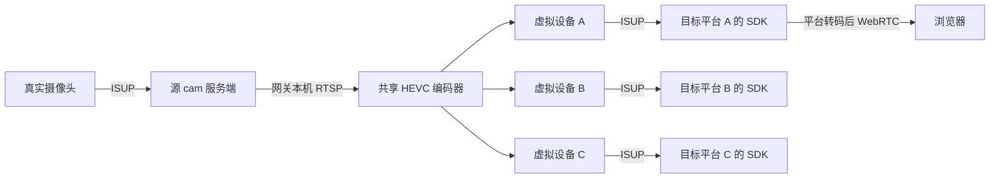

# ISUP 实时预览网关

将一个已经接入 cam 的真实摄像头，以独立虚拟 ISUP 设备身份接入多个目标平台。
每个平台有自己的设备 ID、密钥、注册连接和媒体会话，实时视频源与编码器共享。

已在海康服务端 SDK `2.5.1.35` 上完成注册、开始/停止实时预览，并在目标平台
实际看到真实摄像头画面。客户端运行时不加载海康设备端或服务端 SDK；目标平台
必须有可用的 ISUP 服务端。此仓库提供网关，cam 平台与海康 SDK 需单独准备。

## 协议边界



摄像头到源平台、虚拟设备到目标平台的接入与媒体发送走 ISUP。
源平台的 HTTP API 用于控制取流，本机 RTSP 用于读取源视频，浏览器播放使用
平台自己的播放方案。因此不能把整条链路称为“全部都是 ISUP”。

当前版本将视频转成 **HEVC 704×576、25fps、无音频**，通过 ISUP TCP 媒体
封装发送，目标海康 SDK 输出 PS。它不是原始码流无损透传。

## 安装和启动

推荐 Linux、Python 3.10+，FFmpeg 必须包含 `libx265` 编码器。源 cam 平台需要
提供下面说明的 API，以及能够读取到的本机 MediaMTX RTSP 输出。

```bash
python3 -m venv .venv
.venv/bin/python -m pip install .
cp examples/gateway.single.json config.local.json
chmod 600 config.local.json
```

编辑 `config.local.json` 填写真实源和目标信息，然后先校验、再运行：

```bash
.venv/bin/python -m isup_gateway --config config.local.json --check
.venv/bin/python -m isup_gateway --config config.local.json --status-file status.json
```

安装后也可使用 `isup-gateway` 命令。`Ctrl+C` 或 SIGTERM 会关闭目标媒体会话并
释放网关的源取流。配置检查只输出设备、地址等摘要，不输出密码和密钥。
示例中的 `192.0.2.*` 是文档地址，必须替换；占位密钥仅用于校验文件结构。

## 同时接入三个平台

使用 `examples/gateway.three.json`，或在 `targets` 数组增加两个目标对象。
没有固定的三平台数量限制，每个启用的目标都独立注册。

```json
{
  "label": "platform-a",
  "enabled": true,
  "host": "192.0.2.10",
  "port": 7661,
  "device_id": "GWCAMERA001",
  "device_name": "Gateway camera A",
  "isup_key": "REPLACE_WITH_PLATFORM_A_KEY"
}
```

同时注册不代表始终推流：平台通过其 ISUP SDK 发起预览后，网关才创建媒体会话。
多个平台同时预览时使用一个源编码器；一个平台停止，不影响其他目标。
最后一个目标停止后，网关释放源取流。需要持续画面的平台应保持预览会话。

| 字段 | 说明 |
|---|---|
| `source.api_base` | 源 cam HTTP API，通常为网关本机地址 |
| `source.username/password` | 网关专用取流账号；需有源设备访问权限 |
| `source.device_id/channel` | 真实摄像头 ID 和通道 |
| `source.stream_type` | 源主码流 0、子码流 1 |
| `source.rtsp_base` | 源 MediaMTX RTSP 地址 |
| `source.ffmpeg` | FFmpeg 路径，默认 `ffmpeg` |
| `targets[].host/port` | ISUP 注册 IP/域名和端口；`host` 不包含 URL scheme |
| `targets[].isup_key` | 与该目标服务端一致的 ISUP 接入密钥 |
| `targets[].device_id` | 1～12 个 ASCII 字母、数字、`_` 或 `-` |
| `targets[].device_name` | 名称，最多 128 个 UTF-8 字节 |
| `targets[].label` | 配置中的唯一目标名称 |
| `targets[].enabled` | JSON 的 `true` 或 `false` |
| `targets[].media_host_override/media_port_override` | 可选；默认使用平台下发的媒体接收地址和端口 |
| `targets[].api_base/api_username/api_password` | 可选 cam API，用于设置目标设备列表的显示名称 |

设备名称通过 ISAPI 返回。平台设备列表是否自动使用该名称取决于平台；可选
cam API 只同步显示名称，ISUP 注册与视频发送不依赖它。普通客户平台可以省略
这些 API 字段。不同平台可以使用不同设备 ID；同一注册地址不能重复注册同一 ID。

## systemd 部署

将仓库复制到 `/root/isup-gateway`，创建 `.venv` 并安装依赖，填写
`/root/isup-gateway/config.json`，然后执行：

```bash
install -m 644 isup_gateway/deploy/isup-gateway.service /etc/systemd/system/
systemctl daemon-reload
systemctl enable --now isup-gateway.service
```

修改配置后校验并重启生效：

```bash
/root/isup-gateway/.venv/bin/python -m isup_gateway --config /root/isup-gateway/config.json --check
systemctl restart isup-gateway.service
```

校验命令在 `/root/isup-gateway` 目录执行，或事先通过 pip 安装本项目。
目标地址/ID 改变后需要在目标平台重新打开预览。

```bash
systemctl status isup-gateway.service --no-pager
journalctl -u isup-gateway.service -n 60 --no-pager
cat /root/isup-gateway/status.json
systemctl stop isup-gateway.service
```

状态包含目标在线状态、媒体 SessionID、帧数、字节数、源订阅数、编码器启动次数
和错误。`encoder_starts` 是累计启动次数，发生重试或源重新开启后会增加。

网关应使用专用 cam 账号。源平台的停止接口按账号释放该设备的会话，避免与
管理员或其他程序共用账号造成会话相互影响。当前 cam 实现还要求使用相同的
源码流类型，其他用户切换同一设备的主/子码流会重建源流。

## 源平台和目标平台要求

源 API 契约：

- `POST /api/auth/login`：登录并返回 `token`。
- `POST /api/live/start`：输入设备、通道、码流类型，返回 `stream_ready` 和
  含 `/live/.../` 路径的 `player_url`；该路径也应发布在 `rtsp_base` 下。
- `POST /api/live/stop`：释放该账号的设备预览会话。

网关定期调用开始接口续期源会话。此适配器针对当前 cam API，其他源平台需要
新增源适配器；它不直接调用任意厂商服务端 SDK。

目标需配置 ISUP 5、TCP 实时预览、与网关一致的密钥，并允许虚拟 ID 注册。
目标注册端口和 SDK 下发的媒体地址必须对网关可达。目标网页端口与 ISUP 端口
是不同配置；浏览器展示不需要使用 80 或域名。

`isup_gateway/deploy/` 包含目标 MediaMTX、Nginx 和服务模板，仅是配置参考；
不包含 cam 后端、授权文件、海康 SDK、FFmpeg 或 MediaMTX 二进制。

## 代码结构和维护

| 模块 | 职责 |
|---|---|
| `settings.py` | 配置模型、校验、脱敏摘要 |
| `cam_client.py` | cam 登录、HTTP 请求、登录失效重试 |
| `live_source.py` | 共享源、订阅队列、FFmpeg 生命周期和重试 |
| `hevc.py` | HEVC 文件及增量字节流解析 |
| `media_profile.py` | 已验证媒体配置、编码参数、系统头 |
| `device_session.py` | ISUP 注册、MQTT 心跳、预览控制指令 |
| `isup_protocol.py` / `aes_backend.py` | 认证、加密和控制消息编码 |
| `isup_media.py` | ISUP TCP 帧、RTP、HEVC 分片 |
| `media_sender.py` / `live_sender.py` | 文件/实时媒体会话和独立发送线程 |
| `isapi.py` | 受支持的设备和通道查询回复 |
| `target_worker.py` | 单目标重连与名称同步 |
| `runtime.py` / `live_gateway.py` | 多目标生命周期、状态输出、CLI |

扩展原则和线程关系见 [架构说明](docs/ARCHITECTURE.md)。
下载视频模拟设备的使用方法见 [文件虚拟摄像头](docs/FILE_CAMERA.md)。

## 测试和验证边界

```bash
.venv/bin/python -m unittest discover -s tests -v
.venv/bin/python -m isup_gateway --config examples/gateway.three.json --check
```

自动测试无需真实设备、SDK、抓包或平台密码。覆盖加密已知向量、分片解析、
丢包/队列恢复、配置校验及源共享生命周期。实际接入记录见
[验证说明](docs/VALIDATION.md)。

已验证：ISUP 5、单通道、TCP、HEVC 704×576@25fps、无音频，以及同一目标平台
上的两个独立设备会话共用源编码器。当前实际完成一个外部平台的联调；另外两个
不同客户平台需要分别验证 SDK 版本和取流配置。

尚未实现：原分辨率/码流透传、UDP 媒体、TLS/媒体加密、NPQ、回放、PTZ、报警
转发。私有媒体描述含固定字段，修改分辨率必须重新分析并实测。
